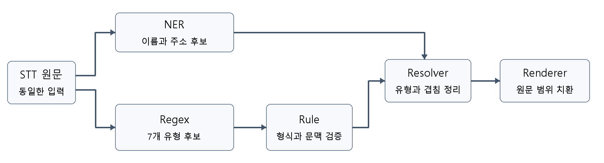

# 개인정보 마스킹 구현 상세 설명서

Android 앱의 STT 확정 발화가 개인정보 후보 탐지, 문맥 검증, 충돌 정리, 토큰 치환을 거쳐 저장되는 과정을 설명한다. 각 단계의 입력과 출력뿐 아니라 복원 규칙, 유형별 조건, 이전 발화 상태, 예외 처리와 현재 검증 범위를 함께 다룬다.

기준 브랜치: feature/android-v1.0_regex-rule-refactor

기준 커밋: 7ac69fb · 작성 기준일: 2026년 9월 25일

## 1 전체 구조와 실제 실행 순서

### 같은 원문을 읽는 두 탐지 경로

NER는 이름과 주소를 찾고, Regex는 전화번호·주민등록번호·카드번호·계좌번호·생년월일·이메일·비밀번호 후보를 찾는다. 둘 다 STT 원문을 입력으로 받는다. NER가 만든 문자열을 Regex에 넘기는 구조가 아니다. Rule은 Regex 후보만 검증하며, NER 후보는 Rule을 거치지 않고 Resolver에서 합류한다.

위 그림은 데이터 의존 관계이다. **두 갈래로 그려져 있어도 현재 코드가 병렬 실행된다는 뜻은 아니다.** MaskingPipeline.maskWithContext()의 실제 호출 순서는 아래와 같다.

~~~kotlin
val nerCandidates = nerDetector.detect(text)
val regexCandidates = regexDetector.detect(text)
val ruleResult = ruleEngine.validateWithContext(
    text, regexCandidates, context)
val resolved = conflictResolver.resolve(nerCandidates, ruleResult)
val maskedText = renderer.render(text, resolved)
~~~

NER 호출이 반환된 뒤 Regex를 호출한다. 이 메서드에는 두 작업을 동시에 시작하는 async나 launch가 없다. suspend는 중단 가능한 함수라는 뜻이며 그 자체로 병렬 실행을 만들지 않는다. NER의 여러 입력 창도 windows.map을 통해 순서대로 추론한다.

### 동시에 진행될 수 있는 작업

SttViewModel의 녹음 작업과 후처리 큐 소비 작업은 별도 코루틴이다. 따라서 다음 음성을 받는 동안 이전 확정 발화를 마스킹할 수 있다. 후처리 큐는 소비자 하나가 순차 처리하고, TranscriptMasker의 Mutex도 문맥 갱신과 마스킹을 직렬화한다. 현재 구조는 **STT와 후처리의 분리**, **한 발화 안의 단계별 순차 실행**으로 이해하면 된다.

문서 구성: 2장은 계약, 3~4장은 NER, 5~9장은 복원과 Regex, 10~15장은 Rule, 16~17장은 Resolver, 18장은 Renderer, 19~20장은 앱 연결과 저장, 21~23장은 예시·검증·파일 안내이다.

<!-- pagebreak -->

## 2 단계별 입출력과 공통 후보 모델

### 공개 계약과 문맥을 전달하는 확장 계약

| 단계 | 입력 | 반환 |
| --- | --- | --- |
| NER detect | 원문 String | PERSON·ADDRESS 후보 목록 |
| Regex detect | 원문 String | 7개 유형의 후보 목록 |
| Rule validate | 원문 + Regex 후보 | 검증을 통과한 후보 목록 |
| Rule validateWithContext | 원문 + Regex 후보 + RuleContext | 후보·범위별 판단·갱신된 문맥 |
| Resolver resolve | NER 후보 + RuleValidationResult | 겹치지 않게 정리된 후보 목록 |
| Renderer render | 원문 + 정리된 후보 | 마스킹된 String |

기존 validate()와 resolve(candidates)는 유지되어 있다. 문맥을 쓰는 경로는 추가된 validateWithContext()와 resolve(nerCandidates, ruleResult)를 사용한다. NumberMaskingRuleEngine이라는 이름은 남아 있지만 실제 중앙 엔진은 이메일과 비밀번호까지 포함한 7개 유형을 처리한다.

MaskingPipeline.mask(text)는 빈 RuleContext로 실행하고 문자열만 돌려준다. 호출 사이의 문맥을 기억하지 않는다. maskWithContext(text, context)는 MaskingPipelineResult를 반환하며, 그 안에 maskedText, resolvedCandidates, updatedContext가 있다. 실제 앱에서 이전 문맥을 보관하는 객체는 TranscriptMasker이다.

### MaskCandidate의 의미

| 필드 | 의미와 제약 |
| --- | --- |
| start | 원문에서 후보가 시작하는 위치. 0 이상 |
| endExclusive | 후보 마지막 글자의 다음 위치. start보다 커야 함 |
| type | MaskType. 후보 또는 최종 범위의 개인정보 유형 |
| source | NER, REGEX, RULE 중 생성 출처 |
| confidence | 선택적 신뢰도. null 또는 0~1 |

범위는 [start, endExclusive)인 반열린 구간이다. 예를 들어 원문 “값 abc 끝”에서 abc는 [2, 5)이고, substring(2, 5)로 값을 얻는다. 위치 단위는 Kotlin String의 UTF-16 인덱스다. 이모지 하나가 인덱스 두 칸을 사용할 수 있으므로 화면상 글자 수와 항상 같지 않다.

현재 NER와 Regex의 confidence는 모두 null이다. Rule을 통과했다고 source를 RULE로 바꾸지는 않는다. 검증된 Regex 후보의 원래 범위·유형·출처를 그대로 유지한다. Resolver가 만드는 MASKED 후보도 현재는 source=REGEX, confidence=null이다.

### 유형과 토큰

PERSON, ADDRESS, PHONE_NUMBER, RRN, CARD_NUMBER, ACCOUNT_NUMBER, BIRTH, EMAIL, PW, MASKED의 10개 유형을 사용한다. Renderer의 토큰은 각 이름을 대괄호로 감싼 값이다. 문맥에 저장되는 유형과 출력 토큰은 역할이 다르다. 문맥은 판단 자료이고, 토큰은 Resolver가 정리한 최종 후보를 치환한 결과다.

<!-- pagebreak -->

## 3 NER 입력 준비와 원문 위치 보존

### 책임과 진입점

OnDeviceNerCandidateDetector는 앱 assets의 KoELECTRA ONNX 모델로 이름과 주소 후보를 생성한다. NerCandidateDetector.detect(text)는 원문을 받고 List<MaskCandidate>를 반환한다. NER 단계는 숫자 유형의 Rule 검증이나 최종 토큰 치환을 수행하지 않는다.

모델 파일은 assets/models/koelectra-ko-pii-ner/model.onnx, 어휘 파일은 같은 폴더의 vocab.txt이다. tokenizer와 inference는 처음 사용할 때 지연 초기화한다. detect()와 close()는 lifecycleLock으로 보호하며, 종료 후 detect()를 호출하면 예외가 발생한다.

### KoElectraTokenizer가 하는 작업

KoElectraTokenizer는 정규화, 기본 토큰 분리, WordPiece 분리, 특수 토큰 삽입을 수행한다. 각 토큰은 모델 입력용 id와 value, 원문 start와 endExclusive를 함께 가진다. 정규화된 글자와 원문 구간을 연결하므로 최종 모델 결과를 원문에 적용할 수 있다.

- NUL, 대체 문자 및 일부 제어·형식 문자를 정리한다. 탭과 줄바꿈 등은 공백으로 취급하되 원문 위치를 유지한다.
- 공백에서 토큰을 나누고, 문장부호와 한자도 별도 기본 토큰으로 분리한다.
- 어휘에 있는 가장 긴 문자열을 먼저 찾는다. 한 기본 토큰의 두 번째 조각부터는 ## 접두어를 사용한다.
- 어휘에 맞는 분해를 찾지 못하거나 기본 토큰이 100개 코드 포인트를 넘으면 해당 구간 전체를 [UNK]로 표현한다.
- 전체 앞뒤에 합성 [CLS]와 [SEP]를 넣는다. 이 둘은 원문 개인정보 범위가 없으므로 [0, 0) 위치를 가진다.

원문 자체에 [PAD], [UNK], [CLS], [SEP], [MASK]가 쓰여 있으면 등록된 토큰으로 인식하고 실제 원문 위치를 부여한다. 자동으로 앞뒤에 넣는 합성 토큰과는 위치 처리가 다르다.

이 구현에는 모든 문자를 소문자로 바꾸는 별도 단계가 없다. 모델 입력을 만드는 동안 원문 String 자체를 수정하지 않는다. 또한 토크나이저에서 긴 발화를 잘라 버리지 않는다. 길이 제한 처리는 다음 단계의 SlidingWindow가 맡는다.

### 어휘와 위치에 대한 검증

vocab.txt는 35,000개 항목이어야 하며 중복이 없어야 한다. 특수 토큰 ID는 [PAD]=0, [UNK]=1, [CLS]=2, [SEP]=3, [MASK]=4를 기대한다. 어휘나 모델을 교체할 때 이 계약과 맞아야 한다.

모델에 들어가는 본문 토큰은 원문 안에 있어야 하고, 앞 토큰의 끝보다 뒤에서 시작해야 한다. UTF-16 서로게이트 쌍 중간을 시작점이나 끝점으로 삼을 수 없다. 이 검증은 이모지 등의 중간을 잘라 잘못된 후보 범위를 만드는 일을 방지한다.

관련 파일: ner/KoElectraTokenizer.kt, ner/OnDeviceNerCandidateDetector.kt, ner/NerCandidateDetector.kt.

<!-- pagebreak -->

## 4 NER 긴 발화 추론과 BIO 결과 해석

### 입력 창과 중복 영역

| 설정 | 현재 값 | 의미 |
| --- | --- | --- |
| 모델 입력 최대 길이 | 512 토큰 | [CLS]와 [SEP] 포함 |
| 본문 최대 길이 | 510 토큰 | 한 창에서 추론하는 실제 본문 |
| 겹치는 본문 | 64 토큰 | 경계 근처 정보를 두 창에서 관찰 |
| 다음 창 이동 폭 | 446 토큰 | 510에서 64를 뺀 값 |

본문이 510토큰 이하이면 한 창을 만든다. 더 길면 전체를 여러 창으로 나눈다. 같은 토큰이 여러 창에 등장하면 양쪽 창 경계로부터의 최소 거리가 더 큰 예측을 선택한다. 이 값도 같으면 본문이 더 긴 창을 선택하고, 두 조건이 같으면 먼저 선택한 결과를 유지한다. 예측 확률을 평균내거나 다수결을 하는 방식은 아니다.

### ONNX 입력과 출력

입력은 input_ids와 attention_mask 두 개이며 INT64, [1, sequenceLength] 형태이다. attention_mask는 실제 입력 토큰에 대해 1이다. 출력 logits는 FLOAT, [1, sequenceLength, 59] 형태를 기대한다. 입력 이름·자료형·차원과 출력 라벨 수가 맞는지 검사한다.

각 토큰의 59개 logit 중 최댓값의 라벨 ID를 선택한다. 같은 최대값이면 순서상 먼저 나온 라벨이 유지된다. softmax 확률이나 신뢰도 임계값으로 후보를 걸러내는 단계는 현재 없다. 무한대나 NaN 같은 비정상 logit은 예외로 처리한다.

### BIO를 개인정보 범위로 바꾸기

| 모델 라벨 | ID | 앱에서 생성하는 유형 |
| --- | --- | --- |
| B_NAME / I_NAME | 31 / 32 | PERSON |
| B_ADDRESS / I_ADDRESS | 3 / 4 | ADDRESS |
| 그 밖의 라벨 | 나머지 ID | 현재 이어진 개체를 종료 |

B는 새 개체의 시작이다. 같은 유형의 I가 이어지면 끝 위치를 확장한다. 앞에 맞는 B가 없는 I 또는 유형이 바뀐 I는 새 개체 시작으로 처리한다. 이어진 토큰 사이의 원문 공백도 최종 시작과 끝 사이에 들어가므로 후보 범위에 포함될 수 있다.

모든 창의 결과를 원문 토큰 순서로 합친 뒤 BIO를 해석한다. 따라서 모델 창이 바뀌는 지점에서도 전체 발화 기준으로 개체를 연결할 수 있다. 생성한 후보는 source=NER이며, Rule을 거치지 않고 Resolver로 전달된다.

입력 텐서와 추론 결과는 사용 후 해제하고, detector.close()는 초기화된 세션을 닫는다. 모델 로딩·추론 오류는 상위로 전달된다. NER 실행 실패를 [MASKED]로 바꾸는 처리는 없다.

관련 파일: ner/NerPostProcessor.kt 안의 NerSlidingWindow, NerBioDecoder, NerLabelSchema와 OnDeviceNerCandidateDetector.kt.

<!-- pagebreak -->

## 5 공통 복원 모델 ChangedText

### 복원 문자열과 원문은 별도로 관리한다

STT가 “골뱅이”, “에이”, “하나”처럼 기록한 표현을 탐지하기 쉬운 문자로 바꾸면 길이가 달라진다. 변환 결과의 위치를 그대로 원문에 적용하면 엉뚱한 구간을 지울 수 있다. ChangedText는 탐지용 text와 원문 경계를 가리키는 originalOffsets를 함께 보관한다.

originalOffsets의 길이는 항상 text.length + 1이다. 문자 자체가 아니라 문자 사이의 경계를 기록하기 때문이다. ChangedText.from(text)는 [0, 1, 2, …, text.length]를 만들어 처음에는 각 경계가 원문의 같은 경계를 가리키도록 한다.

예를 들어 “하나둘”을 “12”로 복원하면 결과 경계 [0, 1, 2]는 원문 경계 [0, 2, 3]에 연결된다. 변환 결과의 [0, 2)를 탐지하면 원문의 [0, 3), 즉 “하나둘” 전체가 후보가 된다.

### 탐지 위치를 되돌리는 공통 방식

~~~kotlin
val originalStart = changed.originalOffsets[match.range.first]
val originalEnd = changed.originalOffsets[match.range.last + 1]
~~~

Regex는 변환된 문자열에서 실행한다. MaskCandidate에는 위처럼 되돌린 **원문 위치**를 넣는다. 이후 Rule, Resolver, Renderer가 받는 후보는 모두 원문 좌표계를 사용한다. 복원된 이메일이나 비밀번호의 문자열은 findEmails(), findPasswords()의 changedValue로 별도 제공한다.

### 여러 복원 단계를 거쳐도 위치를 연결한다

ChangedText.replaceMatches()는 바뀌지 않은 문자의 경계를 복사하고, 치환된 구간은 소비한 길이와 결과 길이에 비례해 경계를 배정한다. 새 경계를 기존 originalOffsets에 다시 연결하여 최초 원문의 좌표를 유지한다. 이는 치환 구간 내부의 모든 글자가 의미상 일대일 대응한다는 뜻은 아니며, 치환된 구간의 시작과 끝을 원문으로 되돌리는 기반이다.

EnglishChange와 SpecialSymbolChange는 이 공통 치환 함수를 사용한다. EmailPatterns의 전용 복원표도 같은 함수를 사용한다. NumberChange는 숫자 표현별 원문 소비 길이를 직접 기록한 뒤 입력 ChangedText의 경계와 합성한다. 구현 방식에는 차이가 있지만 반환 모델과 최종 좌표계는 같다.

### 공백을 없애지 않는 이유

복원 단계에서 공백과 탭을 일괄 삭제하지 않는다. 숫자·이메일·비밀번호 Regex가 중간 공백을 허용해 구간 전체를 잡는다. 숫자 개수, 이메일 형식, 비밀번호 길이를 검사할 때만 별도 값에서 구분 문자를 제외한다. Renderer는 원문 범위를 치환하므로 발음 사이의 공백도 함께 사라진다.

관련 파일: regex/ChangedText.kt, NumberChange.kt, EnglishChange.kt, SpecialSymbolChange.kt.

<!-- pagebreak -->

## 6 숫자 영어 특수문자 복원 규칙

### NumberChange

| 숫자 | 복원하는 한글 표현 |
| --- | --- |
| 0 / 1 / 2 | 공·영 / 일·하나 / 이·둘 |
| 3 / 4 / 5 | 삼·셋 / 사·넷 / 오·다섯 |
| 6 / 7 | 육·여섯 / 칠·일곱 |
| 8 / 9 | 팔·여덟 / 구·아홉 |

숫자 또는 한글 숫자 표현이 두 개 이상 이어진 구간만 변환한다. 사이에는 공백·탭·점·밑줄·하이픈을 허용한다. 단독 “일”을 무조건 1로 바꾸는 전역 치환이 아니다. 아라비아 숫자 바로 뒤의 “이”는 숫자 토큰 시작으로 잡지 않아 “010-1234-5678이고”의 조사를 보존한다. “일이삼”처럼 이어진 표현의 “이”는 2가 된다.

### EnglishChange

기본 대응은 에이=a, 비=b, 씨/시=c, 디=d, 이=e, 에프=f, 지=g, 에이치/에치=h, 아이=i, 제이=j, 케이=k, 엘=l, 엠=m, 엔=n, 오=o, 피=p, 큐=q, 알/아르=r, 에스=s, 티=t, 유=u, 브이=v, 더블유/더블류=w, 엑스=x, 와이=y, 제트=z이다. 이미 있는 영문을 한글로 바꾸거나 대문자로 다시 쓰지는 않는다.

“에이비씨” 또는 “에이 비 씨”처럼 이어진 발음 전체를 한 구간으로 먼저 찾는다. 구간 내부의 “비”가 아직 b인지 확인하는 방식이 아니다. 긴 표현을 먼저 매칭하여 “에이치” 안의 “에이”가 먼저 분리되는 일을 줄인다.

그 구간 바깥의 앞뒤에서 공백·탭을 건너뛴 문자를 검사한다. 양쪽 모두 한글이 아니면 변환한다. 한쪽이 한글이어도 반대쪽이 영문·숫자·이메일 허용 기호이면 변환한다. 양쪽이 한글이거나 한쪽은 한글이고 반대쪽에 그런 연결 근거가 없으면 그대로 둔다. 여기서 한글 검사는 완성형 범위 가~힣을 기준으로 한다.

### SpecialSymbolChange

| 결과 | 인식하는 표현 |
| --- | --- |
| @ | 골뱅이·골벵이·고뱅이·골배이·골뱅니·앳사인·앳 사인·앳 |
| _ / - / + | 언더스코어·언더바 / 하이픈·대시 / 플러스 |
| . / # | 닷·닫·점·쩜 / 샵·해시 |
| % / * | 퍼센트 / 별표 |

특수문자 복원에는 영어 복원과 같은 앞뒤 한글 검사 단계가 없다. 표에 없는 발음은 지원하지 않는다. “이”, “오”, “넷”처럼 의미가 겹치는 표현은 처리 순서의 영향을 받는다. 숫자 복원이 영어보다 먼저이고, 이메일에서는 도메인 전용 복원이 숫자보다 먼저다.

<!-- pagebreak -->

## 7 숫자 유형 Regex 후보 생성

### 중앙 Regex 연결

DefaultRegexCandidateDetector.detect()는 전화번호, 주민등록번호, 카드번호, 계좌번호, 생년월일, 이메일, 비밀번호 탐지 함수를 addAll()로 호출한다. 모은 후보는 start, endExclusive, type.ordinal 순으로 정렬한다. 하나의 구간에 여러 유형이 가능하면 그대로 남긴다. 최종 유형은 이 단계에서 선택하지 않는다.

~~~kotlin
addAll(NumberPatterns.detectPhoneNumbers(text))
addAll(NumberPatterns.detectRrnNumbers(text))
addAll(NumberPatterns.detectCardNumbers(text))
addAll(NumberPatterns.detectAccountNumbers(text))
addAll(NumberPatterns.detectBirthDates(text))
addAll(EmailPatterns.detectEmails(text))
addAll(PasswordPatterns.detectPasswords(text))
~~~

### 숫자 구간과 자릿수

NumberPatterns는 각 숫자 탐지 함수에서 NumberChange.changeWithOffsets(text)를 호출한다. 공통 숫자 구간식은 아래와 같으며, 숫자로 시작하고 끝나고 중간에 숫자·공백·탭·점·밑줄·하이픈을 허용한다.

~~~regex
[0-9](?:[0-9 \t._-]*[0-9])?
~~~

| 후보 유형 | 숫자 개수 | 이 단계에서 아직 검사하지 않는 내용 |
| --- | --- | --- |
| PHONE_NUMBER | 8~11 | 실제 전화번호 접두어와 문맥 |
| RRN | 11~13 | 생년월일과 7번째 숫자 |
| CARD_NUMBER | 14~16 | Luhn과 카드 문맥 |
| ACCOUNT_NUMBER | 9~15 | 계좌 문맥 |
| BIRTH | 5~8 | 실제 달력 날짜와 생일 문맥 |

숫자 개수는 0~9만 남긴 값으로 계산한다. 연속된 긴 숫자 구간 전체가 범위를 벗어나면 앞부분을 잘라 숫자 후보로 만들지 않는다. 다만 별도 PasswordPatterns는 3~64자 규칙으로 같은 긴 숫자열을 PW 후보로 만들 수 있다. “숫자 유형 후보 없음”과 “전체 Regex 후보 없음”은 다르다.

### 년 월 일 표현

BIRTH는 원문에서 두 자리 또는 네 자리 연도와 년 단위를 선택적으로 받고, 월과 일을 포함하는 표현도 직접 찾는다. “1995년 3월 2일”, “95년 3월 2일”, “3월 2일”이 그 형태다. 이 경로는 원문에 실행하므로 완전히 한글 발음으로만 적힌 모든 날짜를 복원하는 규칙은 아니다. 월·일 유효성은 BirthRule에서 검사한다.

각 숫자 함수의 복원은 별도로 실행된다. 모든 유형이 한 번 만든 전역 복원 문자열을 공유하는 구조는 아니다. 이메일과 비밀번호도 각자의 복원 순서로 원문에서 새 탐지용 문자열을 만든다.

<!-- pagebreak -->

## 8 이메일 Regex와 전용 복원표

### 복원 순서

EmailPatterns는 원문에서 ChangedText를 만든 뒤 **이메일 전용 → 특수문자 → 숫자 → 영어** 순으로 복원한다. 전용 표는 EmailPatterns 안의 emailChanges이다. 긴 키부터 우선 매칭한다. 도메인 표현을 먼저 처리하므로 “넷”을 숫자 4로 바꾸기 전에 net으로 만들 수 있다.

| 결과 | emailChanges에 등록된 표현 |
| --- | --- |
| .com / com | 점 컴·닷 컴·점컴·닷컴 / 컴 |
| .net / net | 점 네트·닷 네트·점넷·닷넷 / 네트·넷·넫 |
| gmail | 지메일·쥐메일 |
| naver | 네이버·내이버 |
| daum / nate / yahoo | 다음 / 네이트 / 야후 |

표는 STT 표기 변형까지 포함한다. 예를 들어 “닷넫”은 전용 복원에서 “넫”이 net으로, 특수문자 복원에서 “닷”이 점으로 변환될 수 있다. 전용 표의 단어 자체에는 별도의 앞뒤 경계 검사가 없다. 이후 이메일 형태가 만들어져야 후보가 된다.

### 복원 후 탐지하는 구조

이메일 Regex는 한글 발음으로 이루어진 이메일 전체를 직접 해석하지 않는다. 복원된 문자열의 ASCII 문자만 사용한다. local-part는 영문·숫자 및 이메일 허용 기호로 구성되고, @ 뒤에는 숫자 또는 영문으로 시작하는 도메인 라벨이 필요하다. 라벨 뒤의 점과 다음 라벨은 0회 이상 허용한다.

~~~text
local-part + 공백 허용 + @ + 공백 허용 + domain-label
           + (공백 허용 + . + 공백 허용 + domain-label)*
~~~

local-part의 기호는 . ! # $ % & ' * + / = ? ^ _ ` { | } ~ - 이다. 도메인 라벨의 나머지 문자는 영문·숫자·하이픈이다. 중간 공백은 스페이스와 탭만 허용하며 줄바꿈을 넘지 않는다. 앞뒤 문자 경계 검사도 함께 사용한다.

@만 있어서는 후보가 되지 않는다. 그러나 abc@example처럼 도메인에 점이 빠져도 후보가 될 수 있다. 탐지 단계에는 최상위 도메인 길이 2~4자 제한이 없으며, 실제 이메일 형식과 문맥은 EmailRule이 확인한다.

### 반환과 범위

findEmails()는 원문 start, endExclusive와 공백을 포함할 수 있는 changedValue를 반환한다. detectEmails()는 이를 EMAIL 후보로 바꾼다. “에이 비 씨 골뱅이 지메일 닷컴”은 “a b c @ gmail .com” 형태로 복원되어 탐지되고, 원문 발음 구간 전체가 후보 범위가 된다.

공백을 허용하므로 주변 ASCII 단어까지 같은 후보에 들어갈 수 있다. 잘못된 도메인에서는 유효하게 읽히는 접두 구간만 탐지될 수도 있다. 예를 들어 abc@example..com에서 뒤의 ..com이 후보 밖에 남는 경우가 있다. 이는 전체 이메일 문법 검증기를 구현한 것이 아니라 보호할 후보를 폭넓게 찾는 현재 정책의 특성이다.

<!-- pagebreak -->

## 9 비밀번호 Regex와 후보 길이

### PasswordPatterns의 책임

비밀번호도 Regex는 형태 후보를 만들고 Rule은 채택 조건을 판단한다. PasswordPatterns는 문맥 키워드의 존재를 먼저 요구하지 않는다. 원문을 **특수문자 → 숫자 → 영어** 순으로 복원한다. 이메일 전용 도메인 표는 사용하지 않는다.

허용 문자는 영문 A~Z/a~z, 숫자 0~9와 아래 기호다. 허용 문자가 공백이나 탭으로 이어져 있으면 같은 구간으로 탐지할 수 있다.

~~~text
! @ # $ % ^ & * ( ) _ + = . -
~~~

~~~regex
[A-Za-z0-9!@#$%^&*()_+=.\-]
(?:[ \t]*[A-Za-z0-9!@#$%^&*()_+=.\-])*
~~~

위 두 줄은 실제로 하나로 이어진 식이다. findPasswords()는 탐지한 값에서 공백·탭을 제외한 후 길이가 **3~64자**일 때만 반환한다. 현재 구현에는 최소 길이 3이 있다. 64자를 넘으면 앞의 64자만 남기는 것이 아니라 그 매치를 버린다.

### 후보 생성과 Rule 채택은 다르다

| 입력 형태 | PW 후보 여부 | PasswordRule의 추가 판단 |
| --- | --- | --- |
| abc | 생성 가능 | 비밀번호 문맥이 필요 |
| 123456789 | 생성 가능 | 비밀번호 문맥이 필요 |
| Abc123!@ | 생성 가능 | 8자 이상 3종 혼합이므로 문맥 없이도 채택 |
| ab | 길이 부족 | 후보가 없으므로 Rule도 만들지 않음 |
| 허용 문자 65자 연속 | 해당 매치 제외 | 64자로 잘라서 검증하지 않음 |
| 사과 | 복원 가능한 ASCII 아님 | 일반 한글 단어 비밀번호 탐지 대상이 아님 |

Regex 단계에서 영문·숫자·특수문자 세 종류가 모두 있어야 하는 것은 아니다. findPasswords()가 돌려주는 changedValue는 이미 공백·탭이 제거된 값이다. 원문 후보 범위에는 그 공백들이 남아 있으므로 치환 시 전체 발음 구간을 보호한다.

### 반환과 중복 정리

PasswordPatternMatch는 start, endExclusive, changedValue를 가진다. findPasswords()는 원문 범위가 같은 결과를 중복 제거하고 시작 위치로 정렬한다. detectPasswords()는 source=REGEX, type=PW인 MaskCandidate로 만든다. DefaultRegexCandidateDetector에도 다른 탐지 함수들과 같은 addAll 방식으로 연결되어 있다.

같은 구간이 이메일·숫자 후보이면서 PW 후보일 수 있다. 또한 공백으로 구분된 일반 영문 단어들이 하나의 PW 후보가 될 수 있다. 후보 발생 자체를 최종 마스킹으로 해석하면 안 되며, Rule과 Resolver의 판단까지 확인해야 한다.

<!-- pagebreak -->

## 10 Rule 중앙 실행과 판단 결과 모델

### 중앙 엔진의 처리 순서

DefaultNumberMaskingRuleEngine은 Regex 후보를 받아 RuleContextProcessor로 문맥을 계산한 뒤 유형별 Rule의 assess()를 호출한다. 중앙 엔진에 모든 유형의 세부 검사를 한꺼번에 넣지 않고, 후보 유형과 Rule 객체의 대응표를 관리한다.

1. 모든 후보의 끝 위치가 원문 길이 안에 있는지 검사한다.
2. RuleContextProcessor가 문맥 키워드와 후보를 원문 순서로 처리한다.
3. 각 후보에 대해 해당 유형이 문맥의 지지를 받는지 계산한다.
4. PhoneNumberRule 등 유형별 Rule에서 형식 유효성과 채택 여부를 받는다.
5. 같은 원문 범위의 결과를 RuleCandidateDecision으로 모은다.
6. 채택되었고 제외되지 않은 원래 후보만 남겨 중복 제거·정렬한다.
7. 후보 목록, 판단 목록, updatedContext를 반환한다.

CandidateRuleAssessment는 formatValid와 accepted를 가진다. accepted=true이면 formatValid도 true여야 한다. 형식 유효성은 그 유형을 검토할 기본 조건이고, 채택은 형식과 문맥 또는 자체 규칙을 종합한 결과다. 유형마다 formatValid의 구체적인 기준은 다르다.

### RuleValidationResult와 범위별 판단

| 필드 | 기록하는 내용 |
| --- | --- |
| candidates | 유형별 Rule을 통과하고 제외되지 않은 후보 |
| decisions | 같은 원문 범위마다 작성한 RuleCandidateDecision |
| updatedContext | 이번 발화까지 반영한 다음 발화용 문맥 |

RuleCandidateDecision은 다음 정보를 저장한다. possibleTypes는 Regex가 해당 범위에 붙인 유형, formatValidTypes는 기본 형식을 통과한 유형, supportedTypes는 문맥의 지지를 받으면서 형식도 통과한 유형이다. excludedTypes는 그 범위에서 명시적으로 제외한 유형이다.

acceptedTypesBeforeExclusion은 부정 표현으로 제거하기 전에 유형별 Rule에서 채택된 유형을 보관한다. 이 정보가 있어야 Resolver가 “원래는 보호할 값인데 그 유형만 부정되었다”는 상황에서 [MASKED]로 보호할 수 있다. evidence에는 DIRECT_MARKER, ACTIVE_CONTEXT, FORMAT, NEGATION 중 해당 근거가 기록된다.

supportedTypes는 formatValidTypes 안에 있어야 하며 excludedTypes와 겹칠 수 없다. formatValidTypes와 excludedTypes 등은 possibleTypes 밖의 유형을 포함할 수 없다. noDecision은 지지 유형과 제외 유형이 모두 없다는 뜻이다. 형식 판단이나 후보 자체가 없다는 뜻은 아니다.

Rule은 새 값 구간을 추출하거나, 입력에 없는 유형으로 후보를 재분류하지 않는다. Regex 후보가 비어 있어도 문맥 키워드는 다음 발화용 상태에 반영할 수 있지만, 그 발화의 개인정보 후보를 새로 생성하지는 않는다.

<!-- pagebreak -->

## 11 현재 발화와 이전 발화의 문맥 상태

### RuleContext의 저장 범위

RuleContext.activeTypes는 서로 다른 유형을 최대 3개 보관하는 List이다. PHONE_NUMBER, RRN, CARD_NUMBER, ACCOUNT_NUMBER, BIRTH, EMAIL, PW만 허용한다. PERSON·ADDRESS는 NER 담당이고, MASKED는 최종 보호 결과이므로 여기에 저장하지 않는다.

목록은 오래된 유형부터 최근 유형 순서다. activate(type)는 기존 같은 유형을 제거하고 맨 뒤에 추가한 다음 마지막 3개만 남긴다. 중복 유형을 여러 칸 저장하지 않는다. remove(type)는 해당 유형만 제거한 새 상태를 반환한다.

~~~text
[ACCOUNT_NUMBER, PHONE_NUMBER]
  RRN 활성화 → [ACCOUNT_NUMBER, PHONE_NUMBER, RRN]
  PHONE_NUMBER 재등장 → [ACCOUNT_NUMBER, RRN, PHONE_NUMBER]
  EMAIL 활성화 → [RRN, PHONE_NUMBER, EMAIL]
~~~

최근 순서는 보관·퇴출 기준이다. 교집합에 여러 유형이 남았을 때 무조건 가장 최근 유형을 최종 선택하는 규칙은 없다. 문맥은 최종 토큰이 아니라, Regex가 이미 찾은 유형 중 무엇을 지지할지 판단하는 참고 정보다.

### RuleSupport의 문맥 키워드

| 유형 | 현재 등록된 표현 |
| --- | --- |
| PHONE_NUMBER | 휴대폰 번호, 핸드폰 번호, 전화번호, 연락처, 휴대폰 버노, 핸드폰 버노, 전화버노, 저나버노, 저나번호, 해드폰 번호, 해드폰 버노 |
| RRN | 주민등록번호, 주민번호, 주민등록버노, 주민버노, 주미등록번호, 주미등록버노, 주미번호, 주미버노 |
| CARD_NUMBER | 카드번호, 카드버노 |
| ACCOUNT_NUMBER | 계좌번호, 계좌, 개좌, 개좌번호, 개자번호, 게좌번호, 게자번호, 계좌버노, 개좌버노, 개자버노, 게좌버노, 게자버노 |
| BIRTH | 생년월일, 출생일, 생일 |
| EMAIL | 이메일 주소, 메일 주소, 이메일 |
| PW | PIN 번호, 비밀번호, 패스워드, password, 비번 |

일부 표현 사이에는 공백 문자가 0개 이상 와도 되도록 되어 있다. PW 키워드는 영문 대소문자를 구분하지 않는다. 잘못 적힌 듯 보이는 여러 표현은 STT 인식 변형을 위한 목록이다. 목록에 없는 유사어를 의미 분석으로 자동 확장하지는 않는다.

찾은 키워드는 시작 위치 순, 같은 시작이면 긴 결과 우선으로 정리하고 겹치는 결과를 제거한다. 이 정리는 정규식이 반환한 결과끼리 수행한다. 키워드 전체를 자연어 의도 분류기로 해석하는 구조는 아니다.

<!-- pagebreak -->

## 12 부정 표현과 문맥 이벤트 처리

### 키워드마다 부여하는 세 가지 동작

RuleSupport는 키워드 뒤부터 다음 키워드 또는 문장 경계 전까지를 살핀다. 그 부분의 시작에 지정된 부정·금지 형태가 있는지 확인한다. 문장 경계는 줄바꿈, 캐리지 리턴, 마침표, 물음표, 느낌표다. 쉼표와 콜론은 현재 경계에 포함되지 않는다.

| 동작 | 인식 조건 | 상태에 미치는 영향 |
| --- | --- | --- |
| ACTIVATE | 부정·금지 조건이 없는 키워드 | 해당 유형 활성화, 직접 문맥 설정 |
| REMOVE | 은·는·이·가 등을 거쳐 아니라·아니고·아니에요·말고 | 활성 목록에서 제거, 직접 제외 유형에 추가 |
| IGNORE | 알려 주지·보내지·말하지 + 마세요 | 그 키워드의 새 활성화를 수행하지 않음 |

예를 들어 “계좌번호는 아니라”는 계좌 유형을 제거하는 동작이다. “비밀번호를 알려 주지 마세요”는 새 비밀번호 문맥을 활성화하지 않는다. IGNORE가 기존 비밀번호 문맥을 삭제하거나 값의 마스킹을 금지하는 것은 아니다. 앞의 직접 문맥도 IGNORE만으로 초기화되지 않는다.

부정 표현은 키워드 바로 뒤의 정해진 형태를 기준으로 한다. “안”, “아님”, 긴 부연 설명 뒤의 부정 등 모든 자연어 부정을 이해하는 기능은 아니다. 키워드보다 앞에 있는 부정 표현도 이 규칙으로는 해석하지 않는다.

### RuleContextProcessor의 시간 순서

키워드 이벤트, 같은 범위의 후보 그룹 이벤트, 문장 경계 이벤트를 원문 위치로 정렬한다. 같은 위치라면 키워드, 후보, 경계 순으로 처리한다. 후보를 만났을 때의 문맥을 그 후보에 기록하므로 뒤에서 나온 키워드를 앞의 후보에 소급 적용하지 않는다.

ACTIVATE를 만나면 updatedContext에 유형을 넣고 directType을 해당 유형으로 바꾼다. 그 유형이 직접 제외 목록에 있으면 지운다. REMOVE는 활성 목록에서 유형을 제거하고 directType을 비우며, directlyExcludedTypes에 추가한다. 문장 경계에서는 directType과 직접 제외 목록만 초기화한다.

**문장 경계가 activeTypes까지 초기화하지는 않는다.** “계좌번호 알려주세요.” 다음 문장이나 다음 발화에서도 계좌 문맥이 이어질 수 있다. 반면 직접 문맥과 직접 제외 상태는 한 process() 호출의 지역 상태이며, 이전 발화로부터 그대로 들고 오지 않는다.

현재 경계 검사는 이메일·비밀번호 내부의 마침표나 느낌표를 따로 구별하지 않는다. 후보는 시작 위치 이벤트에서 판단되고, 그 뒤의 경계 이벤트는 이후 후보의 직접 문맥에 영향을 줄 수 있다. 후보 문자열을 그 경계에서 다시 잘라내는 작업은 아니다.

<!-- pagebreak -->

## 13 동일 범위 그룹화와 교집합 계산

### 동일 범위의 기준

후보의 start와 endExclusive가 모두 같으면 같은 그룹이다. 숫자 하나에 PHONE_NUMBER, ACCOUNT_NUMBER, PW가 함께 붙은 경우 해당 범위의 possibleTypes에 세 유형이 들어간다. 일부만 겹치는 범위는 여기서 합치지 않는다. 부분 겹침은 Resolver가 처리한다.

### 현재 문맥을 우선 확인한다

directType이 있고 그 유형이 possibleTypes 안에 있으면 직접 지지 유형으로 사용한다. directType이 있는데 Regex 가능한 유형에 없다면 직접 지지는 없다. 이때 이전 활성 문맥으로 다시 내려가 다른 유형을 선택하지 않는다.

directType이 없을 때만 possibleTypes와 activeTypes의 교집합을 구한다. 교집합의 크기가 정확히 1이면 그 유형을 이전 문맥이 지지한다. 0개면 지지 근거가 없고, 2개 이상이면 하나를 고르기 어렵기 때문에 활성 문맥 지지를 비워 둔다.

~~~text
직접 문맥이 있을 때
  directType ∈ possibleTypes → 직접 지지
  directType ∉ possibleTypes → 지지 없음

직접 문맥이 없을 때
  intersection = possibleTypes ∩ activeTypes
  intersection.size == 1 → 활성 문맥 지지
  그 밖의 경우 → 활성 문맥 지지 없음
~~~

### 판단 예시

| 가능한 유형 | 후보 시점의 문맥 | 문맥 처리 결과 |
| --- | --- | --- |
| PHONE, ACCOUNT, PW | 직접 ACCOUNT | ACCOUNT 지지 |
| PHONE, ACCOUNT, PW | 활성 ACCOUNT 하나 | ACCOUNT 지지 |
| PHONE, ACCOUNT, PW | 활성 ACCOUNT와 PHONE | 교집합 2개라 단일 지지 없음 |
| CARD만 있음 | 직접 ACCOUNT | ACCOUNT 후보를 새로 만들지 않음 |
| EMAIL, PW | 직접 EMAIL | EMAIL 지지 |

표의 PHONE·ACCOUNT·CARD는 각각 PHONE_NUMBER·ACCOUNT_NUMBER·CARD_NUMBER를 줄여 표시했다. 이 단계에서 지지가 없더라도 자체 형식 규칙으로 유형별 Rule이 채택할 수 있다. 예를 들어 문맥 없는 정상 전화번호와 강한 비밀번호 형태는 각각의 Rule 조건으로 통과할 수 있다.

교집합은 기본 형식을 검사하기 전의 possibleTypes를 기준으로 계산한다. 따라서 가능한 유형 두 개가 활성 문맥과 겹쳤다가 이후 형식 검증에서 하나가 탈락해도, 이 단계가 교집합을 다시 계산해 문맥 지지를 부여하지는 않는다. 중앙 엔진은 계산된 지지와 formatValidTypes를 교차해 supportedTypes를 만든다.

직접 제외 유형 역시 possibleTypes 안에 있는 유형만 기록한다. 이 결과와 제외 전 채택 결과를 Resolver에 함께 전달해야 유형을 확정하지 못한 값의 보호 여부를 결정할 수 있다.

<!-- pagebreak -->

## 14 유형별 Rule의 실제 채택 조건

### 전화번호 주민등록번호 카드번호 계좌번호

| Rule | 기본 형식 | 채택 조건 |
| --- | --- | --- |
| PhoneNumberRule | 숫자 형태, 8~11자리 | 전화번호 형태 또는 문맥 지지 |
| ResidentNumberRule | 숫자 형태, 11~13자리 | 13자리 주민번호 형태 또는 문맥 지지 |
| CardNumberRule | 숫자 형태, 14~16자리 | Luhn 통과 또는 문맥 지지 |
| AccountNumberRule | 숫자 형태, 9~15자리 | 반드시 계좌 문맥 지지 |

공통 숫자 검사는 후보 원문을 NumberChange로 복원한다. 숫자 형태에는 숫자 외에 +, 괄호, 점, 밑줄, 하이픈, 공백류를 허용한다. 다만 Rule의 허용 폭이 Regex보다 넓어도 Regex가 후보를 만들지 못한 구간을 새로 발견해 주지는 않는다.

전화번호 자체 형태는 01[016789] 뒤 7~8자리, 02 뒤 7~8자리, 0[3-8][0-9] 뒤 7~8자리, 1[568] 뒤 6자리다. 82로 시작하면 국내형 0으로 바꾸어 이 검사를 하지만, 그 전에 적용되는 8~11자리 기본 조건과 Regex 범위 제한도 여전히 적용된다. 모든 국제번호 형식을 지원하는 것은 아니다.

주민번호 자체 검사는 정확히 13자리이고 7번째 숫자가 1~8인지 확인한다. 1·2·5·6은 1900년대, 나머지는 2000년대로 앞 6자리 날짜를 검사한다. 주민번호 체크섬은 검사하지 않는다. 카드 Luhn은 오른쪽부터 번갈아 두 배를 하고 9를 넘으면 9를 빼서 합산한 값이 10의 배수인지 확인한다. 카드사나 은행별 규격 검증은 없다.

문맥 지지가 있으면 전화 접두어, 주민번호 날짜 형태, 카드 Luhn이 맞지 않아도 기본 길이·문자 조건 안에서 채택될 수 있다. 이는 STT 손상 가능성을 고려한 동작이다. “형식이 맞는다”는 표현을 실제 발급된 번호라는 보증으로 사용하면 안 된다.

### BirthRule

먼저 날짜를 파싱하고 1900~2099년, 월별 일수와 윤년을 검사한다. 구분된 숫자 그룹이 3개 이상이면 처음 세 그룹을 연·월·일로 읽는다. 연도 정규화는 4자리 이상이면 그대로, 짧은 연도가 30 이하면 2000년대, 그보다 크면 1900년대다. 연·월 표기가 없고 숫자만 8자리면 YYYYMMDD, 6자리면 YYMMDD로 읽는다.

정상 연월일은 **문맥 없이 채택한다.** 따라서 회의·예약 같은 일반 일정 날짜도 마스킹할 수 있다. 연도 없는 “3월 2일”은 BirthRule 내부에서 월과 일을 검사하고 생일 문맥이 있어야 채택한다. 이때 2월은 29일까지 허용한다. 월일 검사는 RuleSupport가 아닌 BirthRule에 있다.

앞 조건에 맞지 않는 숫자형 5~8자리도 생일 문맥이 있으면 채택하는 보완 경로가 있다. 따라서 BirthRule 전체가 모든 입력에 대해 엄격한 달력 검증만 수행하는 것은 아니다. 잘못된 “13월 40일”처럼 월·일 단위가 있는 표현은 월일 검사 실패로 탈락한다.

<!-- pagebreak -->

## 15 이메일과 비밀번호 Rule

### 복원 결과를 다시 찾는 방식

EmailRule과 PasswordRule은 후보 원문을 별도의 한글 이메일·비밀번호 Regex로 다시 해석하지 않는다. 각각 EmailPatterns.findEmails(text), PasswordPatterns.findPasswords(text)를 호출하고, 입력 후보와 start·endExclusive가 정확히 같은 결과를 찾는다. 없으면 formatValid=false, accepted=false로 반환한다.

공통 MaskCandidate 안에는 changedValue가 없으므로 현재 구현은 Rule 단계에서 해당 탐지를 다시 실행하여 복원 값을 얻는다. Regex에서 이미 계산한 결과 객체를 파이프라인으로 직접 전달하거나 캐시하는 구조는 아니다. 범위는 최초 Regex 후보 그대로 유지한다.

### EmailRule의 형식과 문맥

이메일 복원 값에서 공백과 탭을 제외하고 전체 길이가 254자 이하인지 확인한다. 같은 범위의 findEmails 결과가 존재하고 이 길이 조건을 통과하면 기본 형식은 유효하다고 본다. 최종 채택은 아래 둘 중 하나가 필요하다.

- EmailRule의 ASCII 이메일 형식과 일치한다.
- 현재 또는 이전 이메일 문맥의 지지를 받는다.

문맥 없이 통과하는 형식은 @ 뒤의 도메인에 적어도 점 하나와 다음 라벨이 있어야 한다. 각 도메인 라벨은 1~63자이고 양끝은 영문 또는 숫자다. 최상위 도메인을 영문 2~4자로 한정하지 않는다. local-part의 연속 점과 같은 모든 이메일 표준 제약을 검사하는 완전한 RFC 검증기는 아니다.

abc@example처럼 점이 빠진 후보는 자체 형식만으로 EMAIL 채택을 받지 못하지만 이메일 문맥으로 통과할 수 있다. 반면 “user at example dot com”의 영문 단어 at·dot은 현재 복원표에 없으므로 문맥만으로 후보가 새로 만들어지지 않는다.

### PasswordRule의 형식과 문맥

| 구분 | 조건 |
| --- | --- |
| 기본 형식 | 같은 범위의 복원 결과 존재, 공백 제외 길이 3~64 |
| 문맥 없는 채택 | 8~64자이며 영문·숫자·허용 특수문자를 모두 포함 |
| 문맥 있는 채택 | 기본 형식을 통과하고 PW 문맥의 지지를 받음 |

“비밀번호: abc”의 abc는 3종 혼합이 아니어도 PW 문맥으로 채택할 수 있다. “Abc123!@”는 8자이며 세 종류가 모두 있어 문맥 없이 통과할 수 있다. 검사에 사용하는 특수문자는 PasswordPatterns의 허용 기호와 같다.

이메일 sample123@gmail.com도 영문·숫자·기호가 모두 포함된 긴 문자열이다. 같은 범위의 EMAIL과 PW가 둘 다 채택될 수 있고, 문맥이 어느 한 유형을 특정하지 않으면 Resolver에서 [MASKED]가 될 수 있다. 값은 보호되지만 이메일 유형명은 최종 결과에 남지 않을 수 있다.

<!-- pagebreak -->

## 16 Resolver의 같은 범위 유형 선택

### Rule 결과와 NER 결과의 합류

DefaultCandidateConflictResolver.resolve(nerCandidates, ruleResult)는 먼저 Rule의 범위별 판단으로 Regex 쪽 최종 후보를 고른다. 그 후보와 NER 후보를 합친 뒤 일반적인 중복·겹침 처리를 실행한다. RuleValidationResult.decisions가 비어 있으면 전달된 candidates를 그대로 합류시켜 기존 인터페이스 사용도 지원한다.

### 같은 범위에서 적용하는 순서

아래 순서는 위에서부터 적용한다. 앞 조건이 충족되면 뒤 조건은 보지 않는다. “채택 유형”은 부정 표현에 따른 제외 후 실제 candidates에 남은 유형이고, “지지받은 채택 유형”은 그중 supportedTypes와 겹치는 유형이다.

| 순서 | 조건 | 선택 결과 |
| --- | --- | --- |
| 1 | 지지받은 채택 유형이 정확히 1개 | 그 유형의 후보 |
| 2 | 지지받은 채택 유형이 2개 이상 | MASKED |
| 3 | 제외 전 채택 유형 중 명시적으로 제외된 유형이 있음 | MASKED |
| 4 | 남은 채택 유형이 정확히 1개 | 그 유형의 후보 |
| 5 | 남은 채택 유형이 2개 이상 | MASKED |
| 6 | 채택은 없지만 기본 형식 유효 유형이 2개 이상 | MASKED |
| 7 | 그 밖의 경우 | 이 범위의 후보 없음 |

예를 들어 EMAIL과 PW가 함께 채택되어도 EMAIL 문맥의 지지가 하나로 정해졌으면 첫 조건에 따라 EMAIL을 선택한다. 문맥 지지가 없으면 다섯 번째 조건에 따라 MASKED가 된다. 따라서 같은 범위의 여러 Rule 유형을 단순 우선순위로만 고르는 구조가 아니다.

### MASKED가 의미하는 것

MASKED는 개인정보 종류를 충분히 확정하지 못했지만 범위를 계속 보호하기 위한 정상 결과다. Regex 가능한 유형과 Rule 문맥의 판단이 맞지 않거나, 여러 형식이 남거나, 채택될 값의 원래 유형이 부정된 상황에서 사용할 수 있다. 다만 모든 모호한 값에 무조건 생성하는 것은 아니고 위 조건에 따라 결정한다.

기본 형식 유효 유형이 하나뿐이고 그 Rule이 채택하지 않은 값은 마지막 조건으로 후보가 사라질 수 있다. 반대로 아무 유형도 채택되지 않았더라도 기본 형식 유효 유형이 여러 개면 보호된다. Rule이 탈락시켰다는 사실만으로 최종적으로 원문이 남는다고 단정할 수 없는 이유다.

이 결정은 Rule이 아닌 Resolver의 책임이다. MASKED 후보의 범위는 해당 RuleCandidateDecision과 같고, source=REGEX, confidence=null이다. 렌더링 이후 maskedTypes에 MASKED를 정상적으로 기록할 수 있으며 실행 오류와 구분된다.

<!-- pagebreak -->

## 17 Resolver의 중복과 부분 겹침 처리

### 정리 절차

같은 범위의 Rule 유형을 선택한 뒤에는 NER까지 포함한 전체 후보를 정리한다. 먼저 start·endExclusive·type이 같은 중복 후보에서 대표 하나를 선택한다. 다음으로 **유형과 출처가 같은 후보끼리 실제로 겹치면 합친다.** 맞닿기만 한 두 범위는 이 단계에서 합치지 않는다.

모든 후보의 시작과 끝을 모아 작은 구간으로 나눈 뒤, 각 구간을 덮는 후보 가운데 우선순위가 가장 높은 후보를 선택한다. 같은 후보가 연속으로 이긴 구간은 다시 이어 붙인다. 겹침에서 진 후보의 비겹침 부분까지 전체 삭제하지 않는다.

### 겹치는 구간의 우선순위

유형 우선순위는 다음과 같다. 숫자가 작을수록 우선한다.

~~~text
1 PW              2 RRN             3 CARD_NUMBER
4 ACCOUNT_NUMBER  5 PHONE_NUMBER    6 EMAIL
7 BIRTH           8 MASKED          9 ADDRESS
10 PERSON
~~~

| 같은 유형일 때 | 출처 우선순위 |
| --- | --- |
| PERSON, ADDRESS | NER → RULE → REGEX |
| PW | RULE → REGEX → NER |
| 그 밖의 유형 | REGEX → RULE → NER |

유형과 출처까지 같으면 같은 출처 안에서 confidence가 높은 후보를 우선한다. null은 신뢰도 비교에서 가장 낮게 취급한다. 이후 시작 위치가 이른 후보, 끝 위치가 더 뒤인 후보, 안정적인 내부 순서로 결정한다. 서로 다른 출처의 confidence 숫자를 먼저 직접 비교하지 않는다.

### 부분 겹침 예시

설명을 위해 ADDRESS가 [0, 12), PHONE_NUMBER가 [5, 10)이라고 가정한다. 전화번호 우선순위가 높으므로 결과는 ADDRESS [0, 5), PHONE_NUMBER [5, 10), ADDRESS [10, 12)로 나뉜다. 주소 후보의 앞뒤를 버리지 않고 각각 보호한다. Renderer는 이 목록에 따라 토큰 세 개를 만들 수 있다.

같은 종류 후보를 합치거나 원래 범위 일부로 잘라낸 경우 confidence는 null이 된다. 원래 전체 범위가 그대로 남는 후보만 기존 confidence를 유지할 수 있다. 반환 목록은 원문 순서이며 서로 겹치지 않는다.

**같은 범위에서의 MASKED 결정과 부분 겹침의 유형 우선순위는 별도 단계다.** “PW가 EMAIL보다 우선하므로 모든 이메일이 PW가 된다”는 설명은 정확하지 않다. 먼저 Rule 판단표로 해당 범위가 EMAIL, PW, MASKED 중 무엇인지 결정할 수 있기 때문이다.

<!-- pagebreak -->

## 18 Renderer의 토큰 치환

### 입력 검증

MaskedTextRenderer.kt에는 인터페이스와 DefaultMaskedTextRenderer 구현이 함께 있다. render(text, candidate)는 원문과 최종 후보를 받는다. 후보가 없으면 원문 그대로 반환한다. 후보가 있으면 시작 위치로 정렬하고 다음을 검사한다.

- 각 후보의 endExclusive가 원문 길이 이하여야 한다.
- 시작과 끝이 UTF-16 서로게이트 쌍 중간을 가르면 안 된다.
- 앞 후보의 끝보다 뒤 후보가 먼저 시작하면 안 된다.

잘못된 범위나 겹친 목록을 받았다고 임의로 줄이거나 무시하지 않는다. require 검사에서 예외가 발생한다. Resolver는 후보 겹침을 정리하고 Renderer는 최종 입력 계약을 확인한다.

### 원문을 앞에서부터 조립한다

Renderer는 결과 문자열을 만드는 sourceIndex를 0에서 시작한다. 각 후보 앞의 원문을 그대로 복사하고, 해당 유형의 마스킹 토큰을 추가한 뒤 sourceIndex를 후보 끝으로 옮긴다. 마지막 후보 이후의 원문도 그대로 붙인다.

~~~text
원문     전화번호는 010-1234-5678입니다
후보     010-1234-5678의 원문 범위와 PHONE_NUMBER
반환     전화번호는 [PHONE_NUMBER]입니다
~~~

토큰이 원래 값보다 길거나 짧아도 이후 후보의 위치가 밀리지 않는다. 수정 중인 문자열의 위치를 다시 사용하는 것이 아니라 항상 원문 범위를 기준으로 복사하기 때문이다.

| 유형 | 치환 토큰 |
| --- | --- |
| PERSON / ADDRESS | [PERSON] / [ADDRESS] |
| PHONE_NUMBER / RRN | [PHONE_NUMBER] / [RRN] |
| CARD_NUMBER / ACCOUNT_NUMBER | [CARD_NUMBER] / [ACCOUNT_NUMBER] |
| BIRTH / EMAIL / PW | [BIRTH] / [EMAIL] / [PW] |
| MASKED | [MASKED] |

### 복원된 값을 출력하지 않는 이유

숫자·영어·특수문자 복원은 탐지와 검증을 위한 내부 처리다. Renderer는 복원된 문자열 전체를 최종 문장으로 출력하지 않는다. 마스킹 범위 바깥의 원문 표기와 공백, 문장부호는 그대로 보존한다. 범위 안의 발음과 공백은 토큰 하나로 함께 치환한다.

Renderer는 어떤 값이 개인정보인지 다시 판단하지 않는다. 이미 정해진 범위와 유형을 출력에 적용한다. 이름이나 주소의 범위가 잘못되었다면 NER 또는 Resolver 쪽 판단을 확인해야 하며, 토큰 출력 책임과 탐지 책임을 구분해야 한다.

<!-- pagebreak -->

## 19 TranscriptMasker와 대화별 상태

### 앱 결과 모델로 연결하기

TranscriptMasker.mask(UtteranceTranscript)는 원문의 마스킹을 수행하고 MaskedTranscript를 만든다. Dispatchers.Default에서 실행하고 contextMutex.withLock 안에서 문맥 선택, 파이프라인 실행, 결과 생성, 상태 갱신을 처리한다. 같은 객체에 동시에 요청해도 문맥 상태를 동시에 수정하지 않는다.

입력 conversationId가 activeConversationId와 같으면 저장된 RuleContext를 사용한다. 다르면 빈 RuleContext로 시작한다. MaskingPipelineResult를 받은 뒤 최종 후보를 시작 위치로 정렬하고 유형을 중복 제거해 maskedTypes를 만든다. 유형 순서는 최종 원문 등장 순서다.

MaskedTranscript 생성까지 성공하면 activeConversationId와 ruleContext를 갱신한다. 파이프라인 또는 결과 생성에서 예외가 발생하면 그 갱신까지 도달하지 않는다. 이후 저장소에 쓰는 작업은 TranscriptMasker 바깥에서 수행하므로, 저장 실패까지 포함한 하나의 트랜잭션은 아니다.

### 상태의 유지 기간과 범위

상태는 한 TranscriptMasker 인스턴스의 메모리에 존재한다. 여러 conversationId의 과거 문맥을 Map으로 보관하지 않는다. A 대화에서 B 대화로 갔다가 A로 돌아오면 마지막 활성 대화와 다르므로 새 문맥으로 시작한다. 앱 재시작이나 객체 재생성 후 문맥 복구, 시간 만료, 일정 발화 수 뒤 자동 초기화는 현재 없다.

후보가 없는 발화라도 “계좌번호 알려주세요”와 같은 키워드가 있으면 문맥이 갱신될 수 있다. 다음 발화의 숫자 후보가 그 문맥을 사용한다. 문맥 보존이 필요하면 매번 pipeline.mask(text)를 직접 부르기보다 이 연결 경로를 사용해야 한다.

### 외부 저장과 전송용 MaskedTranscript

| 필드 | 의미 |
| --- | --- |
| schemaVersion | 현재 1.0 |
| conversationId / utteranceId | 원래 대화 ID와 발화 번호 유지 |
| maskedText | Renderer의 최종 문자열 |
| hasMaskedData | 최종 후보 유형이 하나 이상이면 true |
| maskedTypes | 최종 유형 이름 목록, 중복 없음 |

모델은 비어 있지 않은 대화 ID와 마스킹 문자열, 양수 발화 번호, 중복 없는 유형 목록, hasMaskedData와 목록의 일치를 요구한다. 이 모델에는 rawText 필드가 없다. RuleContext, RuleEvidence, confidence 같은 내부 판단 자료도 현재 저장·전송 모델에 포함하지 않는다.

hasMaskedData는 실제 생성한 후보에 따라 정해진다. 원문에 사용자가 “[EMAIL]”이라는 글자를 써 놓았다는 이유만으로 true가 되는 것이 아니다. MASKED도 다른 유형처럼 정상적인 maskedTypes 항목으로 기록된다.

<!-- pagebreak -->

## 20 STT 연결 저장 전송과 실패 처리

### 확정 발화부터 후처리까지

SttViewModel은 실제 OnDeviceNerCandidateDetector와 Regex, Rule, Resolver, Renderer를 생성해 파이프라인에 연결한다. STT의 endpointDetected가 false이면 partialText만 갱신한다. 발화가 확정되고 finalText가 비어 있지 않을 때 UtteranceTranscript.unmasked()를 만든다.

현재 순서는 **원문 저장 → 후처리 큐에 추가 → 마스킹 → 마스킹 결과 저장 → 선택적 전송**이다. 원문 저장이 마스킹보다 먼저이므로 앱은 원문을 보관한다. 마스킹 결과 모델에 rawText가 없다는 사실과 원문 파일이 존재한다는 사실을 구분해야 한다.

큐는 Channel.UNLIMITED이며 소비자 하나가 순서대로 postProcess()를 실행한다. 녹음 중 다음 확정 발화가 들어오면 큐에 쌓일 수 있다. 이 메모리 큐 자체를 디스크에 영속화하거나, 실패한 후처리를 자동 재시도하는 처리는 현재 연결 코드에 없다.

### 내부 저장 파일

앱 내부 filesDir/storage/conversations/{conversationId} 아래에 발화별 JSON을 저장한다. 원문은 raw_text_0001.json, 마스킹 결과는 masked_result0001.json과 같은 이름을 사용한다. 두 저장소는 기존 목적지 파일을 덮어쓰지 않는다.

같은 대화 디렉터리에 임시 파일을 만들고 UTF-8로 직렬화한 뒤 flush와 파일 동기화를 수행하고, 최종 파일명으로 rename한다. 실패 시 남은 임시 파일을 정리한다. 저장소 작업은 Dispatchers.IO에서 실행한다. 원문 저장과 마스킹 결과 저장은 별도 작업이다.

MaskedTranscriptJsonSerializer의 JSON 키는 schema_version, conversation_id, utterance_id, masked_text, has_masked_data, masked_types이다. 따옴표·역슬래시·개행 등의 문자열 문자를 이스케이프한다. raw_text는 이 직렬화 경로에 들어가지 않는다.

### 전송 연결과 오류

현재 SttViewModel의 maskedTranscriptSender는 null이다. 마스킹 결과를 저장한 뒤 sender가 없으면 반환하므로 실제 서버 전송은 실행하지 않는다. 전송 인터페이스가 존재한다는 사실과 현재 sender가 주입되어 실제 전송된다는 사실은 다르다.

마스킹 또는 결과 저장에서 오류가 발생하면 “원본은 저장됐지만 마스킹 또는 결과 저장에 실패했습니다.”를 표시하고 해당 후처리를 종료한다. sender를 연결한 경우의 전송 실패는 “마스킹 결과는 저장됐지만 서버 전송에 실패했습니다.”로 구분한다. 코루틴 취소는 다시 던진다.

UI의 마스킹·전송 결과는 현재 표시 중인 conversationId와 일치할 때 갱신한다. ViewModel 정리 시 녹음 작업과 큐를 종료하고, 후처리 소비자의 finally에서 NER detector를 닫는다. 모델 실행 실패를 정상 MASKED 결과로 저장하는 기능은 없다.

<!-- pagebreak -->

## 21 단계별 동작 예시

아래 예시는 정책을 설명하기 위한 것이다. NER가 해당 구간에 별도 후보를 추가하지 않는 경우의 Regex·Rule·Resolver 경로를 기준으로 한다. 전체 기기에서 모든 예문을 새로 실행했다는 뜻은 아니다.

### 이전 발화의 계좌 문맥

첫 발화가 “계좌번호 알려주세요”이면 키워드로 ACCOUNT_NUMBER가 활성화된다. 값 후보가 없어도 문맥은 저장된다. 같은 대화의 다음 발화가 “123456789”이면 PHONE_NUMBER, ACCOUNT_NUMBER, PW 등 가능한 후보와 문맥을 비교한다. ACCOUNT_NUMBER만 문맥의 지지를 받아 최종 [ACCOUNT_NUMBER]가 된다.

새 대화에서 “123456789”를 처리하면 이전 문맥을 가져오지 않는다. 번호 형태에 해당하는 기본 형식들이 여러 개 남지만 단일 채택 근거가 부족해 [MASKED]로 보호될 수 있다. 이 대화 전환 예시는 현재 TranscriptMaskerTest에 포함되어 있다.

### 이메일 발음을 원문 전체 범위로 보호하기

~~~text
원문       이메일은 에이 비 씨 골뱅이 지메일 닷컴
전용 복원  이메일은 에이 비 씨 골뱅이 gmail .com
특수 복원  이메일은 에이 비 씨 @ gmail .com
영어 복원  이메일은 a b c @ gmail .com
EMAIL 값   공백 제외 검사값 abc@gmail.com
최종 출력  이메일은 [EMAIL]
~~~

숫자 복원 단계도 실행되지만 이 예에서는 바꿀 숫자 표현이 없다. EmailPatterns와 PasswordPatterns의 복원은 독립적이므로 각각의 후보 범위가 항상 동일하다고 가정해서는 안 된다. 마지막 출력은 EMAIL 문맥과 해당 후보가 선택되는 경로를 보여 준다.

### 비밀번호와 같은 범위 충돌

| 입력 | 핵심 판단 | 이 경로의 결과 |
| --- | --- | --- |
| 비밀번호: abc | 짧은 영문 후보 + PW 문맥 | 비밀번호: [PW] |
| Abc123!@ | 8자, 영문·숫자·특수문자 혼합 | [PW] |
| sample123@gmail.com | EMAIL과 PW가 같은 범위에서 채택, 단일 문맥 없음 | [MASKED] |
| 이메일은 sample123@gmail.com | EMAIL 문맥이 단일 유형 지지 | 이메일은 [EMAIL] |

### 일정 날짜와 월일

“회의는 1995년 3월 2일입니다”의 정상 연월일은 BIRTH Rule을 통과할 수 있다. 현재는 일반 일정이라는 이유로 제외하지 않는다. “생일은 3월 2일”은 유효한 월일과 생일 문맥으로 BIRTH 후보가 통과한다. 문맥 없는 “3월 2일”은 연도 없는 월일 경로에서 BIRTH 채택 조건을 충족하지 못한다.

<!-- pagebreak -->

## 22 현재 검증 결과와 해석 범위

### 남아 있는 실행 기록

현재 작업 폴더의 testDebugUnitTest XML 결과는 2026년 9월 24일 실행 기록이다. 전체 75개 중 68개 통과, 7개 실패, 실행 오류 0개로 기록되어 있다. 이 문서 작성 과정에서는 앱 빌드나 테스트를 새로 실행하지 않았다. 결과 파일은 app/build/test-results/testDebugUnitTest 아래에 있다.

| 검증 영역 | 통과 / 전체 |
| --- | --- |
| Pipeline 계약 / TranscriptMasker | 5 / 5, 1 / 1 |
| NER 토크나이저 / 후처리 / Detector | 4 / 4, 8 / 8, 7 / 7 |
| Regex / Rule | 10 / 12, 12 / 17 |
| Resolver / Renderer | 8 / 8, 8 / 8 |
| 직렬화·저장 ID·입력 모델 | 5 / 5 |

### 실패한 기존 기대값과 현재 구현의 차이

1. 같은 번호에 CARD_NUMBER와 ACCOUNT_NUMBER만 기대한 Regex 테스트에 PW 후보가 추가된다.
2. 긴 숫자열에 후보가 전혀 없기를 기대한 Regex 테스트와 달리, PW의 길이 조건 안이면 PW 후보가 생긴다.
3. 일반 일정 날짜를 제거하기를 기대한 Rule 테스트와 달리, 정상 연월일은 현재 마스킹 대상이다.
4. 카드 후보를 계좌 유형으로 바꾸기를 기대한 테스트와 달리, Rule은 입력에 없는 유형을 만들지 않는다. 계좌는 현재 9~15자리 조건도 적용한다.
5. 영문 at·dot으로 기록된 이메일을 살리기를 기대한 테스트와 달리, 해당 복원은 현재 없다.
6. Regex 후보가 비어 있어도 Rule이 비밀번호를 직접 추출하기를 기대한 테스트와 달리, 현재 Rule은 후보를 새로 만들지 않는다.
7. “비밀번호는 사과입니다”에서 일반 한글 단어를 직접 추출하기를 기대한 테스트와 달리, 현재 PW는 복원 가능한 허용 ASCII 범위만 탐지한다.

이 7개는 기존 기대값과 현재 역할 분리·보호 정책의 차이가 남아 있는 항목이다. 현재 작업에서 해당 기대값을 요구하지 않기로 했더라도 실행 기록은 7개 실패로 남아 있다. 이 기록은 전체 통과가 아닌 68개 통과와 7개 실패로 해석한다.

### 단위 검증과 실제 기기 검증의 차이

TranscriptMaskerTest는 빈 후보를 반환하는 대체 NER와 실제 Regex·Rule·Resolver·Renderer를 연결한다. 이는 대화 문맥 전달과 인터페이스 연결을 검증하지만 실제 모델이 모든 이름·주소를 정확히 탐지한다는 증거는 아니다. NER 구성 요소의 단위 테스트와 실제 Android 기기의 모델 로딩·STT 발화 품질·처리 시간은 구분해야 한다.

실기기에서 마이크 입력부터 모델 추론, 연속 발화, 저장 파일 확인까지의 전체 동작은 별도 확인 대상이다. 현재 문서의 코드 경로 설명은 실행 성능 수치나 개인정보 탐지율 보장을 포함하지 않는다.

<!-- pagebreak -->

## 23 현재 정책의 범위와 파일 안내

### 동작을 읽을 때 기억할 조건

현재 정책은 값의 보호를 우선해 중복된 유형을 MASKED로 정리할 수 있다. 정상 연월일은 일정 문맥에서도 보호하고, 이메일 일부만 탐지되어 뒤쪽 문자가 남는 경우도 있다. 영어·기호 복원표는 등록된 표현에 한정되며, 문맥 처리는 키워드와 정해진 부정 형태에 기반한다.

### 구현 파일을 찾는 기준

아래 파일은 app/src/main/java/com/example/pic_ai_app/masking 기준이다. 클래스 이름과 파일 이름이 항상 같은 것은 아니다. DefaultMaskedTextRenderer는 MaskedTextRenderer.kt에, NER 창 처리와 BIO 해석은 NerPostProcessor.kt에 함께 있다.

| 파일 또는 묶음 | 담당 내용 |
| --- | --- |
| MaskingPipeline.kt | 단계 호출, MaskingPipelineResult 반환 |
| TranscriptMasker.kt | 대화 문맥 보관, MaskedTranscript 생성 |
| model/MaskCandidate.kt, MaskType.kt, MaskSource.kt | 공통 범위·유형·출처 계약 |
| ner/NerCandidateDetector.kt | NER 입력·출력 인터페이스 |
| ner/KoElectraTokenizer.kt | 토큰 분리와 원문 위치 |
| ner/OnDeviceNerCandidateDetector.kt | ONNX 추론과 모델 생명주기 |
| ner/NerPostProcessor.kt | SlidingWindow, 결과 병합, BIO 해석 |
| regex/ChangedText.kt 및 3개 Change 파일 | 복원 문자열과 원문 경계 관리 |
| regex/NumberPatterns.kt, EmailPatterns.kt, PasswordPatterns.kt | 유형별 후보 및 복원 값 |
| regex/DefaultRegexCandidateDetector.kt | 7개 탐지 결과 수집 |
| rule/RuleContext.kt, RuleValidationResult.kt | 상태와 판단 전달 모델 |
| rule/RuleSupport.kt, RuleContextProcessor.kt | 공통 검사·키워드·이벤트·교집합 |
| rule/DefaultNumberMaskingRuleEngine.kt 및 유형별 Rule | 중앙 실행과 7개 유형 검증 |
| resolver/DefaultCandidateConflictResolver.kt | MASKED 선택과 겹침 정리 |
| renderer/MaskedTextRenderer.kt | 최종 원문 범위의 토큰 치환 |

앱 연결은 presentation/stt/SttViewModel.kt, 외부 결과 계약은 domain/model/MaskedTranscript.kt, 직렬화는 data/serialization/MaskedTranscriptJsonSerializer.kt에 있다. 원문과 마스킹 결과 저장은 data/storage의 InternalTranscriptRepository.kt와 InternalMaskedTranscriptRepository.kt를 함께 확인한다.

수정 지점을 찾을 때는 발음 복원은 Change·emailChanges, 후보 범위는 Patterns, 채택 조건은 유형별 Rule, 문맥 상태는 RuleContext 계열, 최종 유형 충돌은 Resolver, 출력 표기는 Renderer를 먼저 확인한다. 입출력 모델을 바꾸는 경우에는 Pipeline, TranscriptMasker, 저장·직렬화 계약까지 연결 범위를 확인해야 한다.
