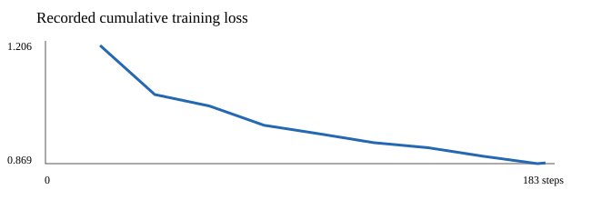
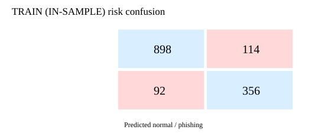
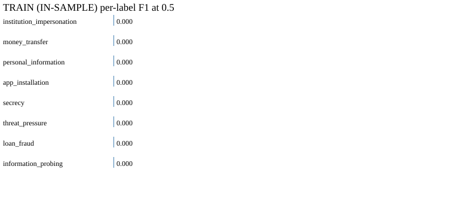

# KoELECTRA v1 정량 평가

**평가 집합: TRAIN (IN-SAMPLE), 1460발화.** 모델이 학습한 발화를 다시 평가한 결과이며 독립 검증·테스트 성능이 아닙니다.

## 학습 기록

- 68개 대화, 1460발화; 피싱 448, 정상 1012.
- 1 epoch, 183 optimizer steps, AdamW, batch size 8, learning rate 2e-5, weight decay 0.01, seed 42.
- 최종 평균 total/risk/type loss: 0.870836 / 0.562352 / 0.308484.
- 과거 20배치 간격 로그는 **해당 시점까지의 누적 평균 loss**다. 각 배치 자체의 loss와 정확한 학습 시작·종료 시각·소요 시간은 `not_recorded`다.

## 피싱 분류 · TRAIN (IN-SAMPLE), 임계값 0.5

Accuracy 0.8589, Precision 0.7574, Recall 0.7946, F1 0.7756, ROC-AUC 0.9237, Average Precision 0.8334, Brier 0.1106.

Confusion matrix `[[TN=898, FP=114], [FN=92, TP=356]]`.
전체 확률 평균/중앙값/모표준편차: 0.3463 / 0.2601 / 0.2575. 양성 평균 0.6232, 음성 평균 0.2237.

## 위험 유형 · TRAIN (IN-SAMPLE), 각 임계값 0.5

| 유형 | 양성 | 음성 | Precision | Recall | F1 | ROC-AUC | AP |
| --- | ---: | ---: | ---: | ---: | ---: | ---: | ---: |
| institution_impersonation | 176 | 1284 | 0.0000 | 0.0000 | 0.0000 | 0.8170 | 0.3483 |
| money_transfer | 90 | 1370 | 0.0000 | 0.0000 | 0.0000 | 0.7414 | 0.1947 |
| personal_information | 32 | 1428 | 0.0000 | 0.0000 | 0.0000 | 0.5231 | 0.0246 |
| app_installation | 6 | 1454 | 0.0000 | 0.0000 | 0.0000 | 0.5485 | 0.0049 |
| secrecy | 21 | 1439 | 0.0000 | 0.0000 | 0.0000 | 0.5905 | 0.0207 |
| threat_pressure | 81 | 1379 | 0.0000 | 0.0000 | 0.0000 | 0.6387 | 0.0930 |
| loan_fraud | 65 | 1395 | 0.0000 | 0.0000 | 0.0000 | 0.8797 | 0.3674 |
| information_probing | 100 | 1360 | 0.0000 | 0.0000 | 0.0000 | 0.6402 | 0.0962 |

Micro P/R/F1 0.0000 / 0.0000 / 0.0000; Macro P/R/F1 0.0000 / 0.0000 / 0.0000; Weighted F1 0.0000; Hamming loss 0.0489; exact match 0.6932.

`app_installation` 양성은 6개뿐이므로 추정치의 신뢰도가 낮다. 유형별 TP/TN/FP/FN과 정의 불가능한 지표의 사유는 `metrics.json` 및 `per_label_metrics.csv`에 있다.
기본 임계값에서 모든 유형의 TP와 FP가 0이다. 따라서 유형별 F1은 모두 0이며, 높은 exact match 비율은 주로 빈 라벨 발화를 모두 음성으로 맞춘 결과다. 유형별 AUC/AP는 순위 정보일 뿐 현재 임계값의 탐지 성공을 의미하지 않는다.

## CPU 추론 측정

- 모델 로딩 16.76초, 첫 단일 추론 442.41ms.
- 워밍업 3회 후 길이별 단일 발화 24회: 평균 409.88ms, p50 210.79ms, p95 1039.01ms.
- 전체 평가 batch 8: 3.58발화/초. 관측 working set 1338994688 bytes (separate follow-up run: checkpoint load plus one batch-1 CPU inference; sampled process working set, not full-evaluation peak).
- 길이별 표본, 반복 횟수 및 측정 범위는 `inference_benchmark.json` 참조.

## 재현성 및 한계

- 데이터 버전 `risk-speech-team_lead_training_use_20261026_27-8faa6a7eebfe`; Git 데이터 커밋 `8faa6a7eebfe95c7ac7fe6c6077a49ebf31f958f`.
- 체크포인트 SHA-256 `1131f9dcc665f79073d98ecd6845573109a89e44dbf2917d299a8fea057020a7`.
- 팀장 학습 사용 승인은 발화별 사람 검수 완료를 뜻하지 않는다. LLM 보정 없는 마스킹 텍스트를 사용했으므로 백엔드 실제 추론 입력과 차이가 있다.
- 제외 174발화. 상세 사유, 입력 파일 SHA-256, 중복 통계는 `reproducibility.json` 참조.
- 이 모델은 1 epoch 학습됐고 코드·체크포인트는 검증됐지만 **독립 데이터 일반화 성능은 검증되지 않았다**. 현재 1,460발화를 나중에 분할해도 독립 TEST가 되지 않는다.

