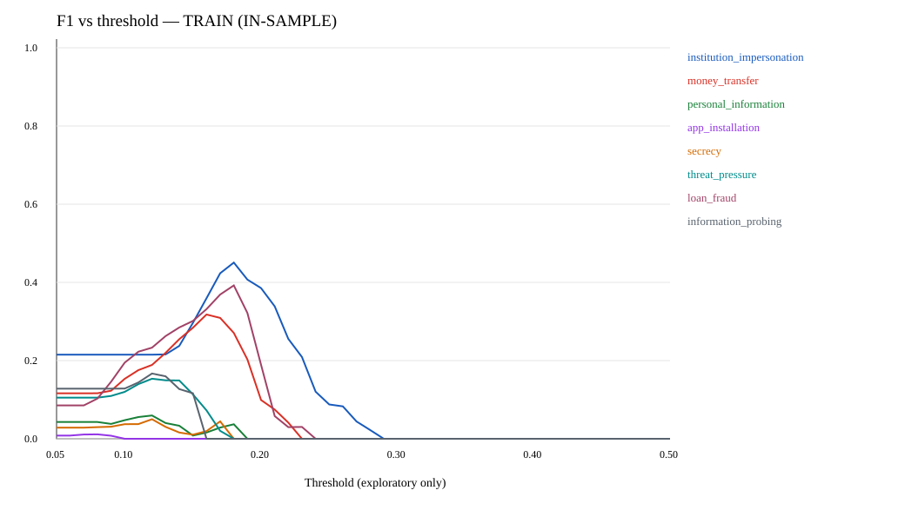
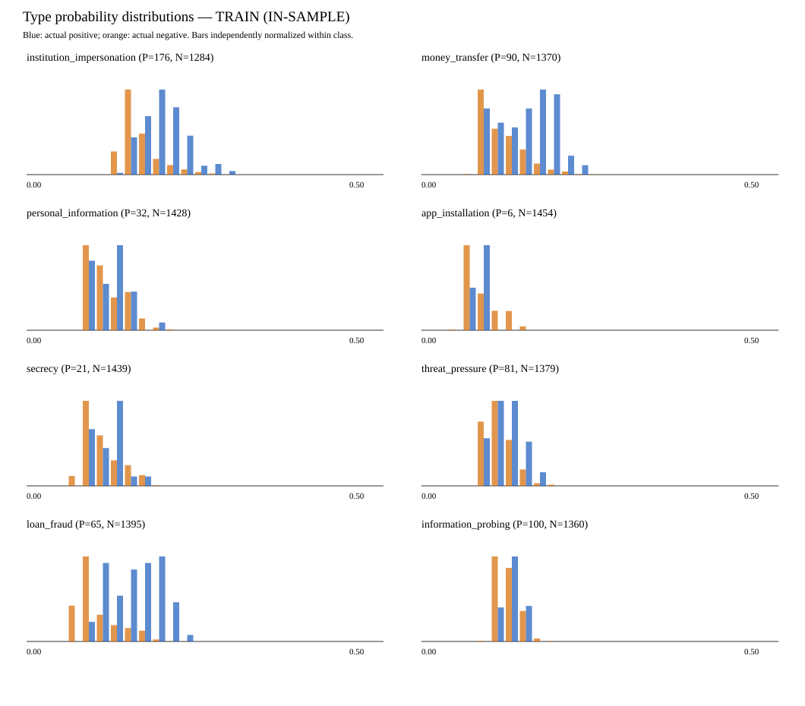

# 위험 유형 확률 및 임계값 진단

**평가 집합: TRAIN (IN-SAMPLE), 기존 학습 발화 1,460개.** 기존 체크포인트를 재로딩하고 학습·추론 공통 입력 구성으로 8개 유형의 확률을 다시 계산했다. 독립 검증 또는 테스트 성능이 아니다. 기본 추론 임계값 0.5와 체크포인트는 변경하지 않았다.

## 유형별 확률 분포

아래 확률은 0~1 단위다. `+`와 `-`는 실제 라벨을 뜻한다. 전체 분위수와 0.1/0.2/0.3/0.4/0.5 이상 예측 수, 표준편차, 평균 차이, 양·음성의 평균·중앙값·최댓값은 [probability_distribution.csv](probability_distribution.csv)에 모두 기록했다.

| 유형 | 실제 + / - | + 평균 / 중앙값 / 최댓값 | - 평균 / 중앙값 / 최댓값 | 전체 p50 / p95 / p99 | ROC-AUC / AP | 평균 차이 (+ − -) |
| --- | ---: | ---: | ---: | ---: | ---: | ---: |
| institution_impersonation | 176 / 1,284 | .196 / .191 / .286 | .163 / .155 / .281 | .157 / .227 / .261 | .817 / .348 | +.0334 |
| money_transfer | 90 / 1,370 | .150 / .152 / .225 | .118 / .107 / .248 | .108 / .182 / .212 | .741 / .195 | +.0323 |
| personal_information | 32 / 1,428 | .118 / .121 / .182 | .116 / .108 / .214 | .108 / .162 / .184 | .523 / .025 | +.0016 |
| app_installation | 6 / 1,454 | .084 / .081 / .099 | .088 / .079 / .171 | .079 / .134 / .146 | .548 / .005 | −.0040 |
| secrecy | 21 / 1,439 | .115 / .121 / .174 | .110 / .101 / .194 | .102 / .162 / .174 | .590 / .021 | +.0056 |
| threat_pressure | 81 / 1,379 | .122 / .122 / .172 | .113 / .107 / .197 | .108 / .147 / .174 | .639 / .093 | +.0095 |
| loan_fraud | 65 / 1,395 | .156 / .160 / .231 | .103 / .092 / .224 | .093 / .171 / .194 | .880 / .367 | +.0534 |
| information_probing | 100 / 1,360 | .131 / .129 / .158 | .125 / .122 / .186 | .122 / .152 / .162 | .640 / .096 | +.0062 |

확률이 모든 발화에서 같은 값은 아니다. 다만 대부분 .1 전후의 좁은 구간에 모인다. `loan_fraud`와 `institution_impersonation`은 학습 집합에서 순위 구분 신호가 비교적 강하다. `personal_information`과 `app_installation`은 ROC-AUC가 .5에 가까워 임계값 변경만으로 유용한 분류기로 보기 어렵다. 특히 `app_installation`은 실제 양성 6개뿐이며 양성 평균 확률이 음성 평균보다 낮다.

0.3 이상 확률은 어느 유형에서도 없었다. 0.5에서는 8개 유형 모두 TP=FP=0, Recall=F1=0이다. 이것이 기존 유형별 F1=0의 직접 원인이다.

## 임계값 변경 실험

[threshold_sweep.csv](threshold_sweep.csv)에 유형마다 0.05~0.50을 0.01 간격으로 조사한 46개 지점의 TP/FP/FN, 양성 예측 수, Precision/Recall/F1을 기록했다. 아래의 최대 F1은 **같은 학습 데이터에서 탐색한 참고 수치**다. 배포 임계값으로 채택할 근거가 아니다.

| 유형 | 참고 임계값 | TP / FP / FN | Precision / Recall / F1 |
| --- | ---: | ---: | ---: |
| institution_impersonation | .18 | 121 / 240 / 55 | .335 / .688 / .451 |
| money_transfer | .16 | 41 / 127 / 49 | .244 / .456 / .318 |
| personal_information | .12 | 17 / 521 / 15 | .032 / .531 / .060 |
| app_installation | .08 | 4 / 699 / 2 | .006 / .667 / .011 |
| secrecy | .12 | 11 / 408 / 10 | .026 / .524 / .050 |
| threat_pressure | .12 | 42 / 424 / 39 | .090 / .519 / .154 |
| loan_fraud | .18 | 20 / 17 / 45 | .541 / .308 / .392 |
| information_probing | .12 | 78 / 757 / 22 | .093 / .780 / .167 |

예를 들어 임계값 .2에서 `institution_impersonation`은 TP 73, FP 130, FN 103 (P/R/F1=.360/.415/.385), `loan_fraud`는 TP 7, FP 2, FN 58 (.778/.108/.189)이다. .1에서는 `app_installation`이 TP 0, FP 376이고, `information_probing`은 TP 100, FP 1,356이다. 임계값을 낮추면 감지는 생기지만 유형별 오탐 비용이 크다. 모든 유형에서 .3/.4/.5의 양성 예측 수는 0이다.

히스토그램의 양성·음성 막대는 **각 집단 안에서 별도로 정규화**했다. 두 막대 높이로 실제 발생 건수나 정밀도를 직접 비교하면 안 된다.
